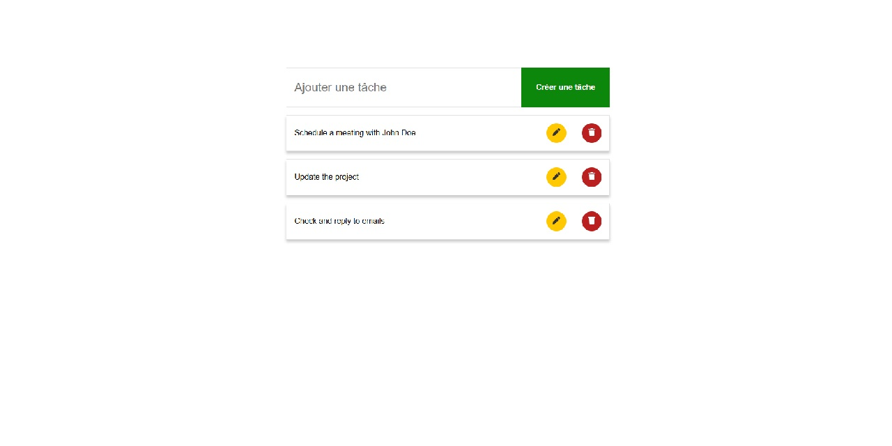

  

## Objectif du projet

L’interface permet d’ajouter une tâche, de la modifier et de la supprimer. Une vérification empêche également les doublons.

### Réalisations techniques

- Gérer et mettre à jour l’état d’une application en fonction des interactions utilisateur.
- Transmettre des données et des fonctions entre composants.
- Découper l’interface en composants réutilisables.
- Mettre à jour une liste sans modifier directement les données existantes.
